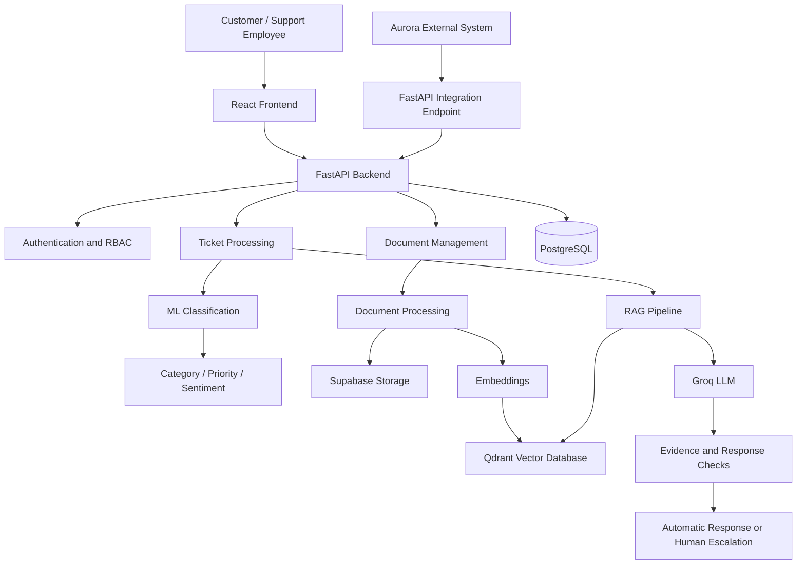
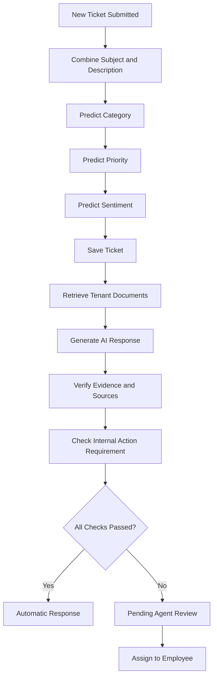

# FixFlow — AI-Powered Customer Support & Issue Resolution

FixFlow is a multi-tenant AI-powered customer support platform designed to streamline ticket management, automate issue classification, retrieve relevant information from company documents, and assist support teams with intelligent response generation.

It combines machine learning, retrieval-augmented generation (RAG), and human-in-the-loop workflows to help organizations manage customer issues more efficiently while keeping responses grounded in their own documentation.

---

## Table of Contents

1. [Overview](#overview)
2. [Key Features](#key-features)
3. [System Architecture](#system-architecture)
4. [Ticket Processing Workflow](#ticket-processing-workflow)
5. [AI and Machine Learning Components](#ai-and-machine-learning-components)
6. [Technology Stack](#technology-stack)
7. [Database and Storage](#database-and-storage)
8. [Aurora Integration](#aurora-integration)
9. [Project Structure](#project-structure)
10. [Getting Started](#getting-started)
11. [Environment Configuration](#environment-configuration)
12. [Running the Application](#running-the-application)
13. [Database Migrations](#database-migrations)
14. [API Documentation](#api-documentation)
15. [Limitations and Future Improvements](#limitations-and-future-improvements)

---

## Overview

Traditional customer support systems often require support employees to manually categorize incoming tickets, determine their urgency, search through company documentation, and prepare responses.

FixFlow addresses these challenges through an integrated AI-assisted workflow.

When a ticket is submitted, the platform:

- Predicts its category.
- Estimates its priority.
- Analyzes its sentiment.
- Searches relevant company documentation.
- Generates a context-grounded response.
- Evaluates whether the response is sufficiently supported.
- Automatically handles eligible tickets or escalates them to a human employee.

FixFlow also supports organization-level data isolation, role-based access, document management, and external ticket intake through its Aurora integration.

## Key Features

### 1. Intelligent Ticket Management

- Create, view, update, and manage support tickets.
- Automatically categorize incoming issues.
- Predict ticket priority.
- Analyze customer sentiment.
- Track ticket status and assignment.
- Support human intervention when automated resolution is unsuitable.

### 2. AI-Powered Ticket Classification

FixFlow uses trained machine learning models to identify the nature and urgency of incoming customer issues.

Classification includes:

- Category prediction.
- Priority prediction.
- Sentiment analysis.

### 3. Document-Based Question Answering

Organizations can upload their own documentation to provide relevant knowledge for AI-generated responses.

Supported document formats:

- PDF
- DOCX
- TXT
- Markdown

The document processing pipeline extracts text, divides it into chunks, generates embeddings, and indexes them for semantic retrieval.

### 4. Retrieval-Augmented Generation (RAG)

FixFlow uses RAG to generate responses based on the organization's uploaded documentation.

The system:

1. Converts the incoming query into an embedding.
2. Retrieves relevant document chunks.
3. Restricts retrieval to the appropriate tenant.
4. Sends the retrieved context to the language model.
5. Generates a response using the available evidence.
6. Returns supporting source information separately.

The generation prompt instructs the model not to invent information or rely on unsupported external knowledge.

### 5. Human-in-the-Loop Escalation

Not every ticket should be resolved automatically.

FixFlow checks response availability, supporting sources, evidence, and whether the issue requires internal action.

If the checks are not satisfied, the ticket is routed for human assistance rather than being treated as successfully resolved.

### 6. Multi-Tenant Architecture

- Separate organizations within one platform.
- Tenant-scoped ticket and document operations.
- Role-based access control.
- Organization registration and approval workflow.
- Employee invitations and account management.

### 7. Document Management

- Upload organization-specific documents.
- Store document files using Supabase Storage.
- Index document content in Qdrant.
- Retrieve relevant information for ticket responses.
- Delete documents and their associated vector records.

### 8. Aurora Integration

FixFlow supports external ticket intake through a server-to-server integration secured using a Bearer integration key and a configured tenant identifier.

---

## System Architecture

FixFlow follows a frontend-backend architecture with separate services for relational data, file storage, vector retrieval, and AI processing.



### Component Responsibilities

| Component | Responsibility |
|---|---|
| React + Vite | User interface and dashboard |
| FastAPI | Backend APIs and application logic |
| PostgreSQL | Relational application data |
| SQLAlchemy | Database interaction and ORM |
| Alembic | Database schema migrations |
| Supabase Storage | Uploaded document storage |
| Qdrant | Vector storage and similarity search |
| Sentence Transformers | Text embedding generation |
| Scikit-learn | Machine learning classification |
| Groq | LLM-powered response generation |

---

## Ticket Processing Workflow

The following workflow describes how FixFlow processes a newly submitted ticket.



### Workflow Explanation

1. **Ticket intake:** A customer or external integration submits a ticket.
2. **Text preparation:** The subject and description are combined for analysis.
3. **Category prediction:** The classification model identifies the issue category.
4. **Priority prediction:** The priority service estimates ticket urgency.
5. **Sentiment analysis:** The sentiment model analyzes the ticket text.
6. **Database storage:** The ticket and its predicted attributes are saved.
7. **Document retrieval:** Relevant chunks are retrieved from the organization's indexed documents.
8. **Response generation:** The language model generates a response using retrieved context.
9. **Validation:** FixFlow checks response availability, source information, evidence, and internal-action requirements.
10. **Final handling:** Eligible tickets can receive an automated response. Other tickets are marked for agent review and assigned for human assistance.

The Aurora ticket intake workflow also uses classification, response generation, and automated-versus-human handling.

---

## AI and Machine Learning Components

### 1. Category Classification

FixFlow uses a trained classification model to identify the type of customer issue.

The category classifier currently supports 18 categories:

| Category ID | Category |
|---|---|
| BANKING | Banking & Account Services |
| CARDS | Cards & Payments |
| DIGITAL_BANKING | Digital & Online Banking |
| TRANSFERS | Fund Transfers & Transactions |
| LOANS | Loans & Credit Services |
| FRAUD | Fraud & Disputes |
| DEPOSITS | Deposits & Investments |
| COMPLIANCE | KYC & Compliance |
| TECHNICAL | Technical Support |
| ACCOUNT_ACCESS | Account Access & Authentication |
| BILLING | Billing & Invoicing |
| REFUNDS | Refunds & Cancellations |
| SERVICE_REQUEST | General Service Requests |
| PRODUCT | Product & Service Information |
| DOCUMENTATION | Documents & Verification |
| NETWORK | Network & Connectivity |
| HARDWARE | Hardware & Device Support |
| OTHER | Other / Unclassified |

The prediction returns both a category identifier and its human-readable category name.

### 2. Priority Prediction

FixFlow uses a hybrid priority prediction approach.

The priority service combines:

- TF-IDF-based classification.
- MiniLM-based classification.
- Probability averaging between the two prediction outputs.
- Configurable critical-pattern rules.

The final predicted class is selected using the combined probability distribution.

Critical-pattern rules can override the predicted priority when configured conditions are matched.

### 3. Sentiment Analysis

FixFlow includes a trained sentiment model for banking-related customer messages.

The model predicts sentiment from the incoming ticket text and returns the predicted sentiment along with model metadata.

Sentiment prediction is handled separately from category and priority prediction.

### 4. Embedding Generation

FixFlow uses the `BAAI/bge-m3` embedding model through Sentence Transformers.

The embedding pipeline:

- Converts document chunks into vector representations.
- Uses normalized embeddings.
- Produces 1024-dimensional vectors.
- Stores the resulting vectors in Qdrant.

### 5. Retrieval-Augmented Generation

The RAG pipeline combines semantic search with LLM-based response generation.

**Document ingestion**

1. Extract text from uploaded documents.
2. Clean and process extracted text.
3. Divide content into smaller chunks.
4. Generate embeddings.
5. Store vectors and document metadata in Qdrant.

**Query processing**

1. Receive the customer query.
2. Generate its embedding.
3. Search the Qdrant collection.
4. Apply tenant-specific retrieval filtering.
5. Retrieve relevant document chunks.
6. Pass the retrieved context to the language model.
7. Generate a response with supporting source information.

The configured default retrieval settings include:

- Collection: `fixflow`
- Top retrieved chunks: `5`
- Minimum similarity score: `0.45`
- Maximum retrieval limit: `20`

These values can be configured through environment variables.

### 6. LLM Response Generation

FixFlow integrates Groq through an OpenAI-compatible client.

The default configured model is:

`openai/gpt-oss-120b`

The response-generation instructions emphasize:

- Using only retrieved document context.
- Avoiding unsupported assumptions.
- Not inventing information.
- Returning an insufficient-evidence response when the retrieved context is inadequate.
- Keeping citations separate from the generated answer.

An additional evidence-verification step is enabled in the automatic ticket intake workflows.

---

## Technology Stack

| Category | Technologies |
|---|---|
| Frontend | React 19, React DOM, Vite 8 |
| Backend | Python, FastAPI |
| Database | PostgreSQL, SQLAlchemy |
| Database Migrations | Alembic |
| Authentication | JWT, PyJWT, password hashing |
| Machine Learning | Scikit-learn, Joblib |
| Data Processing | NumPy, Pandas, SciPy |
| NLP and Embeddings | Sentence Transformers, Transformers |
| Deep Learning Framework | PyTorch |
| Vector Database | Qdrant |
| LLM Integration | Groq, OpenAI-compatible client |
| File Storage | Supabase Storage |
| Document Processing | PyMuPDF, python-docx |
| Email | SMTP |
| API Server | Uvicorn |

---

## Database and Storage

FixFlow separates relational application data, uploaded files, and vector representations.

### PostgreSQL

PostgreSQL stores the platform's structured application data.

Important entities include:

| Entity | Purpose |
|---|---|
| Tenant | Organization information |
| User | Organization users and platform roles |
| EmployeeCategory | Employee category relationships |
| Ticket | Customer support tickets |
| Document | Uploaded document metadata |
| Draft | AI-generated response drafts and their status |
| Invitation | Employee invitation records |
| OrganizationAccessRequest | Organization registration requests |

SQLAlchemy manages database interaction.

Alembic manages schema changes through versioned migrations.

### Supabase Storage

Supabase Storage stores uploaded document files.

The default bucket name is:

`fixflow-documents`

The storage configuration is managed through environment variables.

### Qdrant

Qdrant stores document embeddings and their associated metadata.

Each indexed document chunk contains metadata such as:

- Tenant identifier.
- Document identifier.
- Source information.
- Filename.
- Section.
- Text content.
- Chunk identifier.

Tenant filtering helps prevent retrieval across organizations.

---

## Aurora Integration

FixFlow includes an external integration pathway for Aurora.

The integration allows Aurora to submit support tickets to a configured FixFlow tenant.

### Authentication

The integration uses a Bearer token supplied through the `AURORA_INTEGRATION_KEY` configuration.

The backend:

1. Checks whether the integration key is configured.
2. Validates the supplied Bearer credential.
3. Checks whether the Aurora tenant identifier is configured.
4. Validates the tenant identifier as a UUID.
5. Associates the incoming ticket with the configured tenant.

### Integration Configuration

The integration requires:

- `AURORA_INTEGRATION_KEY`
- `AURORA_TENANT_ID`

The integration key must be kept confidential and must never be exposed in frontend code or committed to version control.

---

## Project Structure

```text
FixFlow/
│
├── backend/
│   ├── alembic/
│   │   └── versions/
│   │
│   ├── ml_models/
│   │   ├── category_classifier.py
│   │   ├── embedding_service.py
│   │   ├── fixflow_category_model_clean.pkl
│   │   ├── priority_model.joblib
│   │   └── priority_service.py
│   │
│   ├── sentiment_artifacts/
│   │   ├── fixflow_banking_sentiment_metadata.json
│   │   └── fixflow_banking_sentiment_model.joblib
│   │
│   ├── services/
│   │   ├── __init__.py
│   │   └── assignment.py
│   │
│   ├── database.py
│   ├── email_service.py
│   ├── main.py
│   ├── models.py
│   ├── schemas.py
│   ├── security.py
│   ├── supabase_client.py
│   ├── rag_service.py
│   ├── vector_store.py
│   ├── ingestion.py
│   ├── chunking.py
│   ├── cleaning.py
│   ├── embed_store.py
│   ├── sentiment_service.py
│   ├── requirements.txt
│   └── alembic.ini
│
├── datasets/
│   ├── banking77_train.csv
│   ├── bitext_mapped.csv
│   ├── fixflow_category_train_clean.csv
│   ├── fixflow_manual_examples.csv
│   ├── build_clean_dataset.py
│   ├── train_final_category_model.py
│   └── test_category_model.py
│
├── frontend/
│   ├── public/
│   ├── src/
│   │   ├── assets/
│   │   ├── App.jsx
│   │   ├── Dashboard.jsx
│   │   ├── documents.jsx
│   │   ├── App.css
│   │   ├── dashboard.css
│   │   ├── index.css
│   │   └── main.jsx
│   │
│   ├── package.json
│   ├── package-lock.json
│   └── vite.config.js
│
├── .gitignore
└── requirements.txt
```

*The structure above highlights the main application files and omits generated files, virtual environments, local environment files, and archived datasets.*

---

## Getting Started

### Prerequisites

Install the following before setting up FixFlow:

- Python 3.11 or a compatible Python version.
- Node.js and npm.
- PostgreSQL database.
- Supabase project with Storage configured.
- Qdrant instance.
- Groq API key.

You will also need SMTP credentials if you want to use invitation email functionality.

### 1. Clone the Repository

```bash
git clone https://github.com/sachdevaanshita78-commits/FixFlow.git
cd FixFlow
```

### 2. Set Up the Backend

Open a terminal in the project root.

```powershell
cd backend
python -m venv venv
```

Activate the virtual environment on Windows:

```powershell
.\venv\Scripts\Activate.ps1
```

Install backend dependencies:

```powershell
pip install -r requirements.txt
```

### 3. Configure Backend Environment Variables

Create a `.env` file inside the `backend` directory.

Add the required configuration variables. Refer to the [Environment Configuration](#environment-configuration) section.

### 4. Run Database Migrations

From the `backend` directory:

```powershell
alembic upgrade head
```

This applies the existing Alembic migrations to the configured database.

### 5. Set Up the Frontend

Open another terminal in the project root:

```powershell
cd frontend
npm install
```

Create a `.env` file inside `frontend` if you need to configure a custom backend URL.

---

## Environment Configuration

FixFlow uses environment variables to configure external services and application behavior.

### Backend Configuration

Create `backend/.env`:

```env
# Database
DATABASE_URL=your_postgresql_connection_string

# Authentication
JWT_SECRET_KEY=your_secure_random_secret

# Supabase
SUPABASE_URL=your_supabase_project_url
SUPABASE_SERVICE_KEY=your_supabase_service_role_key
SUPABASE_BUCKET=fixflow-documents

# Qdrant
QDRANT_URL=your_qdrant_url
QDRANT_API_KEY=your_qdrant_api_key
QDRANT_COLLECTION=fixflow

# Groq
GROQ_API_KEY=your_groq_api_key
GROQ_BASE_URL=https://api.groq.com/openai/v1
GROQ_MODEL=openai/gpt-oss-120b

# RAG Configuration
RAG_MODEL_NAME=BAAI/bge-m3
RAG_MIN_SCORE=0.45
RAG_TOP_K=5
RAG_GENERATION_REASONING=low

# SMTP
SMTP_HOST=smtp.gmail.com
SMTP_PORT=587
SMTP_EMAIL=your_email
SMTP_APP_PASSWORD=your_email_app_password

# Aurora Integration
AURORA_INTEGRATION_KEY=your_aurora_integration_key
AURORA_TENANT_ID=your_aurora_tenant_uuid
```

**Important:**

- Replace placeholders with your own credentials.
- Use a strong, randomly generated JWT secret.
- Never commit `.env` files or expose service keys.
- Aurora credentials are needed only when enabling the integration.
- SMTP settings are needed for invitation email functionality.
- Use a valid PostgreSQL connection string compatible with Psycopg.

### Frontend Configuration

Create `frontend/.env`:

```env
VITE_API_BASE_URL=http://127.0.0.1:8000/api/v1
```

The frontend uses this variable to communicate with the backend API.

---

## Running the Application

### Start the Backend

From the `backend` directory, with the virtual environment activated:

```powershell
uvicorn main:app --reload
```

The backend will be available at:

```text
http://127.0.0.1:8000
```

### Start the Frontend

From the `frontend` directory:

```powershell
npm run dev
```

Vite will display the local development URL in the terminal, normally:

```text
http://localhost:5173
```

### Verify the Backend

Open the following endpoint:

```text
http://127.0.0.1:8000/
```

Health endpoints:

```text
http://127.0.0.1:8000/health/live
http://127.0.0.1:8000/health/ready
```

---

## Database Migrations

FixFlow uses Alembic to maintain database schema versions.

Migration files are stored in:

```text
backend/alembic/versions/
```

To apply all available migrations:

```powershell
alembic upgrade head
```

To check the current migration revision:

```powershell
alembic current
```

To view migration history:

```powershell
alembic history
```

Run these commands from the `backend` directory with the backend environment configured.

---

## API Documentation

FixFlow exposes REST APIs through FastAPI.

Once the backend is running, interactive API documentation is available at:

**Swagger UI**

```text
http://127.0.0.1:8000/docs
```

**ReDoc**

```text
http://127.0.0.1:8000/redoc
```

### Main API Functional Areas

| Functional Area | Capabilities |
|---|---|
| Authentication | Login and current-user information |
| Organization Management | Registration and organization administration |
| Platform Administration | Organization requests and platform metrics |
| User Management | Tenant users and invitations |
| Ticket Management | Ticket creation, retrieval, updates, and deletion |
| AI Answer Generation | Generate document-grounded answers |
| Document Management | Upload, list, and delete documents |
| Aurora Integration | External ticket intake |
| Health Checks | Application liveness and readiness |

Refer to Swagger UI for the exact endpoint paths, request schemas, response models, and authentication requirements.

---

## Limitations and Future Improvements

Potential areas for further development include:

- Expanding classification datasets to support more industries and issue types.
- Improving model evaluation and monitoring using additional real-world ticket data.
- Adding more detailed analytics for ticket resolution and employee performance.
- Improving automated response quality through expanded evidence validation.
- Adding more comprehensive automated tests.
- Supporting additional external customer support integrations.
- Improving observability, logging, and production deployment workflows.

These are development opportunities rather than claims about existing functionality.

---

## Security Considerations

FixFlow uses several security mechanisms:

- JWT-based authentication.
- Role-based access control.
- Tenant-scoped data operations.
- Bearer authentication for Aurora integration.
- Environment-based credential management.
- Tenant-specific vector retrieval.

Keep API keys, database credentials, JWT secrets, and service-role keys outside the source code.

---

## Author

**Anshita Sachdeva**

B.E. Computer Science and Engineering  
Artificial Intelligence and Machine Learning

**GitHub:** [sachdevaanshita78-commits](https://github.com/sachdevaanshita78-commits)

---

*FixFlow — Smarter ticket management through AI, knowledge retrieval, and human collaboration.*